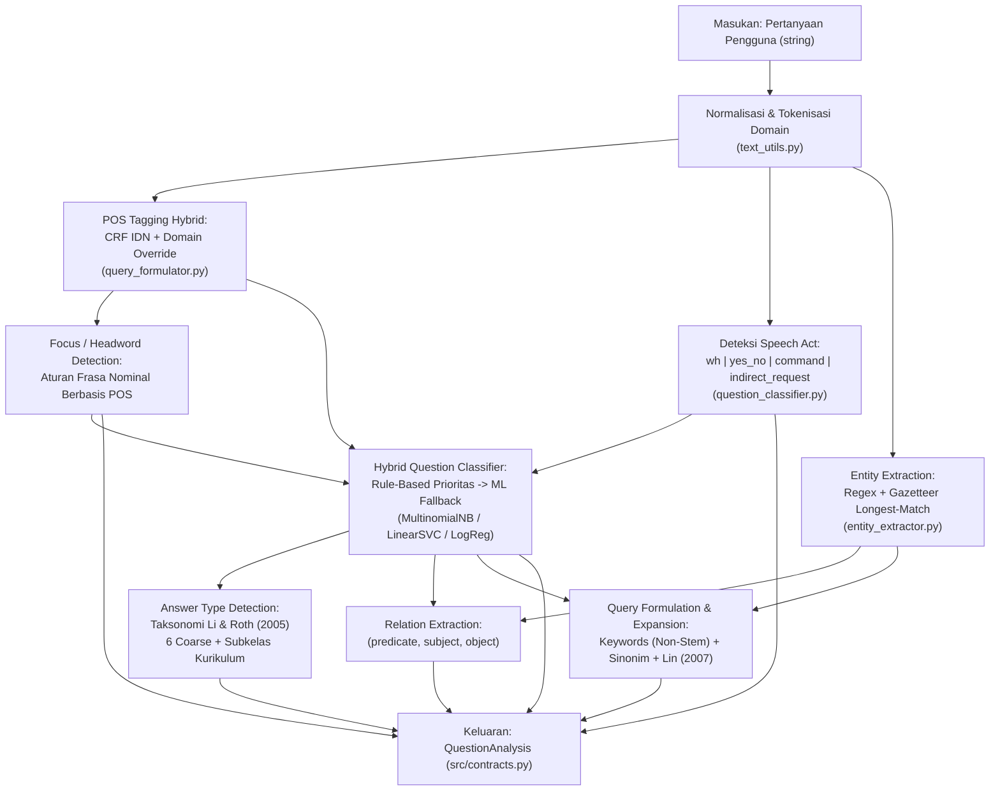

# Draf Bahan Bab III — Metodologi Penelitian (Bagian Anggota 3: Question Processing)

> **Catatan Penulis (Yusuf):** Sesuai pedoman TP, diagram alir metodologi pada Bab III harus menggambarkan tahapan teknis penelitian secara spesifik (masukan, proses, dan keluaran), bukan bagan teori umum studi literatur. Tulis ulang bagian ini menjadi narasi Bab III bersama tim.

---

## 3.X Rancangan Alur Question Processing

### Diagram Alir Tahapan Question Processing

---

## 3.X Rancangan Taksonomi Pertanyaan & Penyesuaian Li & Roth

Sistem mendefinisikan **21 kelas `intent`** (20 intent domain Kurikulum 2024 TIF UB + 1 kelas `other` untuk pertanyaan di luar domain), **5 `question_category`** (`factoid`, `definition`, `list`, `narrative`, `yes_no`), dan pemetaan ke **6 kelas `coarse` Li & Roth (2005)** beserta subkelas `fine`:

*(Salin tabel lengkap dari `docs/question_taxonomy.md` §1 beserta catatan penyesuaian:)*
1. **Semester → `NUMERIC:order`**: nomor semester (`1–8`) bermakna urutan/peringkat ordinal, bukan durasi (`NUMERIC:period`).
2. **Kode MK → `NUMERIC:code`**: dalam taksonomi Li & Roth, kode identifikasi alfanumerik seperti kode pos atau kode MK masuk ke `NUMERIC:code`.
3. **Aturan Peralihan → `DESCRIPTION:manner`**: pertanyaan "bagaimana aturan peralihan..." menanyakan prosedur/ketentuan pelaksanaan.
4. **Pertanyaan Ya/Tidak → `DESCRIPTION:yes_no` & `question_category="yes_no"`**: membedakan pertanyaan konfirmasi (`course_practicum`) dari pertanyaan faktual terbuka.

---

## 3.X Rancangan Leksikon & Dataset Latih/Uji

1. **Gazetteer Mata Kuliah (`course_lexicon.json`)**:
   - Diekstrak secara *read-only* dari PDF pedoman (`pdfplumber` pada halaman tabel 18–24 dan tabel penyetaraan 40–43, dilengkapi *pymupdf* pada header silabus halaman 50–100) menghasilkan **72 entri Kurikulum 2024** dan **57 entri Kurikulum 2020**.
   - Inkonsistensi kode antar-bab di dokumen asli (mis. `CIF60048`/`CIF60050` untuk MLOps, `CIF63106`/`CIF63107` untuk APS, `CIF63108`/`CIF63109` untuk IMK, `CIF63110`/`CIF63310` untuk Kecerdasan Artifisial, `MPK60007`/`UBU60007` untuk Bahasa Indonesia, serta tabrakan `MPK60003` antara Tabel 6.2 Kewirausahaan dan Silabus Agama Kristen) dipetakan lewat `code_aliases` dan *override* halaman 18 agar seluruh kode tetap dikenali menuju entitas yang benar.
   - Alias populer mahasiswa (mis. `AI`, `KA`, `KAL`, `APS`, `IMK`, `RPL`, `PAPB`, `MLOps`) serta variasi ejaan korpus tabel & visual Anggota 1/2 (mis. `Penjaminan Kualitas PL`, `Big Data Analytics`, `Arsitektur Jaringan Moderen`, `Penyediaan dan Otomasi Layanan`, `Tugas Akhir / Skripsi`) dikurasi manual.
2. **Leksikon Domain (`domain_lexicon.json`)**: mencakup 11 *learning path* (selaras 100% dengan `knowledge_triples.jsonl` Anggota 2), 3 kelompok MK pilihan dengan nama kanonik persis (`Perekayasa Perangkat Lunak`, `Perekayasa Infrastruktur Komputasi`, `Perekayasa Komputasi Cerdas`), 31 Bahan Kajian CC2020/CS2023 Tabel 4.1 (`knowledge_areas`, selaras dengan predikat `supports_cpl`), 11 kode CPL (`IF_CPL_*`), 17 singkatan, kamus sinonim, kata tanya `wh_words`, kata perintah `command_words`, dan `question_stopwords` selektif (mempertahankan negasi `tidak`).
3. **Dataset Latih (`questions_labeled.json`) & Uji (`questions_test.json`)**:
   - **252 pertanyaan latih** (12 pertanyaan per intent × 21 intent) dengan variasi tindak tutur (`wh`, `command`, `indirect_request`, `yes_no`) dan gaya informal (mis. `brp sks papb?`).
   - **63 pertanyaan uji *held-out*** (3 pertanyaan per intent × 21 intent) menggunakan mata kuliah/kode/frasa yang berbeda dari data latih. Kebebasan kebocoran data diverifikasi secara otomatis (`train_norm.isdisjoint(test_norm)`).
4. **Dataset POS Tagging**:
   - **IDN Tagged Corpus UI**: 10.030 kalimat dipecah *seed=42* menjadi **9.027 kalimat latih (90%)** dan **1.003 kalimat uji (10%)**; token multi-kata (`pesta olahraga\tNN`) dipecah per spasi dengan tag identik.
   - **Domain Gold (`pos_domain_gold.tsv`)**: 20 pertanyaan kurikulum yang dianotasi manual mengikuti tagset IDN untuk mengukur dampak *domain lexicon override* terhadap akurasi POS.

---

## 3.X Rancangan Eksperimen Modul Question Processing

1. **Evaluasi POS Tagger**: membandingkan akurasi CRF murni pada 10% *held-out* IDN, akurasi CRF murni pada 20 kalimat domain, dan akurasi CRF + *Domain Override* pada 20 kalimat domain.
2. **Perbandingan Classifier ML (5-Fold Stratified CV)**: membandingkan `MultinomialNB(alpha=0.5)`, `LinearSVC(C=1.5)`, dan `LogisticRegression(C=3.0, max_iter=1000)` menggunakan gabungan fitur TF-IDF unigram+bigram teks, TF-IDF unigram+bigram urutan POS tag, dan fitur *headword* (`focus`) dengan metrik **Accuracy** dan **Macro-F1**.
3. **Studi Ablasi pada Held-Out (`questions_test.json`)**: membandingkan performa varian **Rule-based Only**, **ML Only**, dan **Hybrid (Rule + ML + kalibrasi ambang `LinearSVC.decision_function < -0.32` dari 5-fold CV data latih)** untuk membuktikan kontribusi masing-masing lapisan.
4. **Evaluasi Komponen & Keselarasan Lintas-Modul A2 ↔ A3**: akurasi *Speech Act*, akurasi *Answer Type* (*coarse* & *fine*), *Precision/Recall/F1* ekstraksi entitas pada 15 fixture resmi, serta uji kecocokan langsung 15 predikat GATE-A dan 8 soal tim (`eval_q05_q08.json` + `eval_q09_q12.json`) terhadap `data/processed/knowledge_triples.jsonl` (1.177 triple milik Anggota 2).
