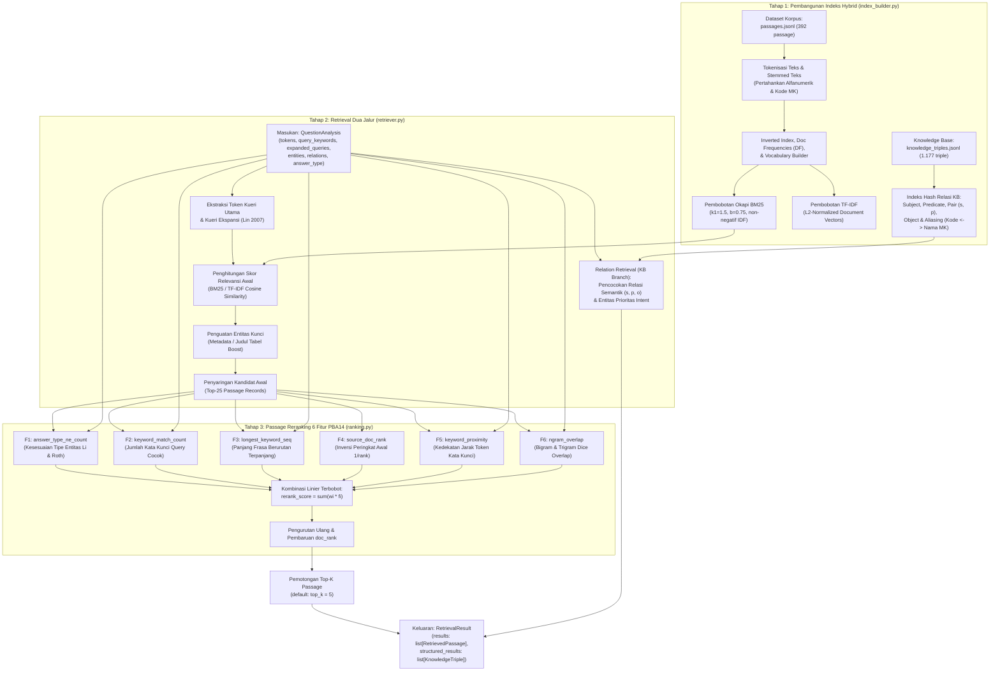

# Draf Bahan Bab III — Metodologi Penelitian (Bagian Anggota 4: Passage Retrieval & Reranking)

> **Catatan Penulis (Azza Arsyada):** Dokumen ini menguraikan metodologi penelitian, alur proses komputasi, rancangan struktur data indeks, dan skenario evaluasi modul *Passage Retrieval, Relation Retrieval, dan Passage Reranking* sesuai format spesifik Bab III Laporan Proyek Akhir.

---

## 3.X Rancangan Alur Modul Retrieval & Reranking

Modul Retrieval bertindak sebagai subsistem penghubung yang menerima representasi pertanyaan dari Modul 3 (*Question Processing*) dan korpus hasil pemrosesan Modul 2 (*Preprocessing & Structuring*), kemudian menyaring kandidat *passage* teks paling relevan serta mengambil fakta terstruktur (*triples*) yang dibutuhkan oleh Modul 5 (*Answer Processing*).

### Diagram Alir Tahapan Retrieval & Reranking

---

## 3.X Rancangan Struktur Data & Pembuatan Indeks

### 1. Struktur Data `RetrievalIndex`
Struktur data indeks dirancang secara terpadu (*unified*) menggunakan kelas `RetrievalIndex` yang menyimpan:
- `vocab`: Kamus pemetaan term ke indeks integer ($V \to \mathbb{Z}$).
- `inverted_index`: Tabel hash term yang memetakan term ke daftar pasangan tuple `(doc_idx, tf)` untuk mempercepat kalkulasi dot-product sparse.
- `idf`: Nilai bobot *Inverse Document Frequency* yang dihitung secara *pre-computed*.
- `doc_lens` dan `avg_dl`: Panjang masing-masing dokumen serta rata-rata panjang dokumen pada korpus (untuk normalisasi BM25).
- `doc_vectors`: Daftar kamus vektor bobot TF-IDF ternormalisasi $L_2$ per dokumen untuk kalkulasi *Cosine Similarity* instan.

### 2. Algoritma Pembobotan Teks Klasik
Penelitian membandingkan dua paradigma pencarian klasik:
1. **Okapi BM25:** Menggunakan formula Robertson-Spärck Jones non-negatif dengan parameter saturasi frekuensi $k_1 = 1.5$ dan normalisasi panjang dokumen $b = 0.75$.
2. **TF-IDF Vector Space Model:** Menggunakan formulasi pembobotan sublinier dengan pelembutan Laplace pada komponen IDF dan normalisasi kosinus pada ruang berdimensi jarang (*sparse vector*).

### 3. Indeks Relasi Terstruktur (*Knowledge Base Branch*)
Untuk mendukung cabang *Structured KB-QA* (PBA14 Slide 75), dibangun struktur indeks hash multi-arah:
- `kb_pair_index`: Memetakan pasangan `(subject_normalized, predicate)` ke daftar `KnowledgeTriple` untuk pencarian relasi berkecepatan $O(1)$.
- `kb_subject_index`: Memetakan nama subjek entitas ke seluruh fakta terkait.
- `kb_predicate_index`: Memetakan predikat ke seluruh fakta terkait.
- `kb_subject_aliases`: Tabel pemetaan bolak-balik antara kode mata kuliah (mis. `CIF64311`) dan nama resmi mata kuliah (mis. `Kecerdasan Artifisial Lanjut`), sehingga pencarian menggunakan nama atau kode tetap mengarah pada simpul pengetahuan yang sama.

---

## 3.X Rancangan Pemeringkatan Ulang (*Passage Reranking*) Berbasis 6 Fitur PBA14

Tahap pemeringkatan awal (*first-stage retrieval*) menghasilkan kolam kandidat sebanyak $M = \max(25, \text{top\_k} \times 4)$. Seluruh kandidat diproses oleh fungsi `extract_passage_ranking_features` untuk mengekstraksi 6 vektor fitur:

| Kode Fitur | Nama Fitur | Definisi Operasional pada Domain Kurikulum | Formula / Normalisasi |
|---|---|---|---|
| $f_1$ | `answer_type_ne_count` | Frekuensi kemunculan entitas/indikator gramatikal pada passage yang bersesuaian dengan tipe jawaban Li & Roth dari pertanyaan (`NUMERIC:count`, `NUMERIC:grade`, `ENTITY:prerequisite`, `DESCRIPTION:manner`, dll.) | $\min\left(\frac{\text{count}}{10.0}, 1.0\right)$ |
| $f_2$ | `keyword_match_count` | Jumlah kata kunci pertanyaan (*query keywords*) yang ditemukan di dalam teks passage | $\min\left(\frac{\text{matched\_keywords}}{10.0}, 1.0\right)$ |
| $f_3$ | `longest_keyword_seq` | Jumlah kata kunci kueri terpanjang yang muncul berturut-turut tanpa jeda pada teks passage (menjaga keutuhan frasa nama MK) | $\min\left(\frac{\text{max\_seq}}{5.0}, 1.0\right)$ |
| $f_4$ | `source_doc_rank` | Inversi peringkat dokumen asal dari tahap retrieval pertama | $\frac{1.0}{\text{doc\_rank}}$ |
| $f_5$ | `keyword_proximity` | Rasio kedekatan token: jumlah kata kunci yang cocok dibagi rentang jarak token terpendek antara kata kunci pertama dan terakhir | $\frac{|K_{\text{matched}}|}{\text{span}_{\min} + 1.0}$ |
| $f_6$ | `ngram_overlap` | Nilai koefisien Dice rata-rata untuk bigram dan trigram antara teks pertanyaan normal dan teks passage | $\frac{1}{2}\text{Dice}_2 + \frac{1}{2}\text{Dice}_3$ |

Skor akhir pemeringkatan ulang dihitung menggunakan kombinasi linier terbobot terkalibrasi:
$$\text{rerank\_score} = 0.35 \cdot \hat{S}_{\text{base}} + 0.15 \cdot f_4 + 0.15 \cdot f_2 + 0.10 \cdot f_3 + 0.10 \cdot f_5 + 0.10 \cdot f_6 + 0.05 \cdot f_1$$
di mana $\hat{S}_{\text{base}} = \frac{S_{\text{base}}}{\max(S_{\text{base}})}$ adalah skor retrieval awal ternormalisasi min-max.

---

## 3.X Rancangan Evaluasi Retrieval

Evaluasi modul dilakukan secara otomatis terhadap dataset uji korpus kurikulum menggunakan metrik standar:
1. **Recall@K ($K \in \{1, 3, 5, 10\}$):** Persentase pertanyaan di mana nomor halaman sumber (*ground truth source page*) berhasil terjaring dalam daftar $K$ passage teratas.
2. **Retrieval Mean Reciprocal Rank (MRR):** Rata-rata nilai timbal balik dari posisi peringkat pertama ditemukannya passage yang benar:
   $$\text{Retrieval MRR} = \frac{1}{|Q|} \sum_{i=1}^{|Q|} \frac{1}{\text{rank}_i}$$
3. **Studi Komparasi & Ablasi:**
   - Membandingkan efektivitas retrieval antara algoritma probabilistik Okapi BM25 dan Vector Space Model TF-IDF.
   - Menguji dampak kontribusi modul pemeringkatan ulang (*Passage Reranking* 6 fitur) terhadap peningkatan Recall@1 dan Retrieval MRR dibandingkan penelusuran tanpa reranking (*raw retrieval*).
