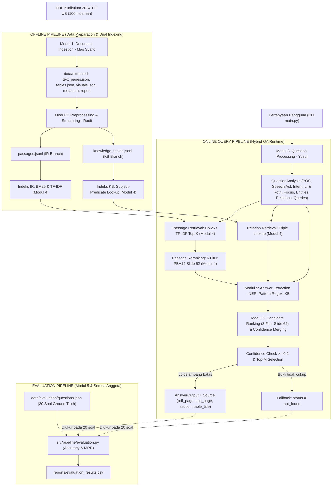
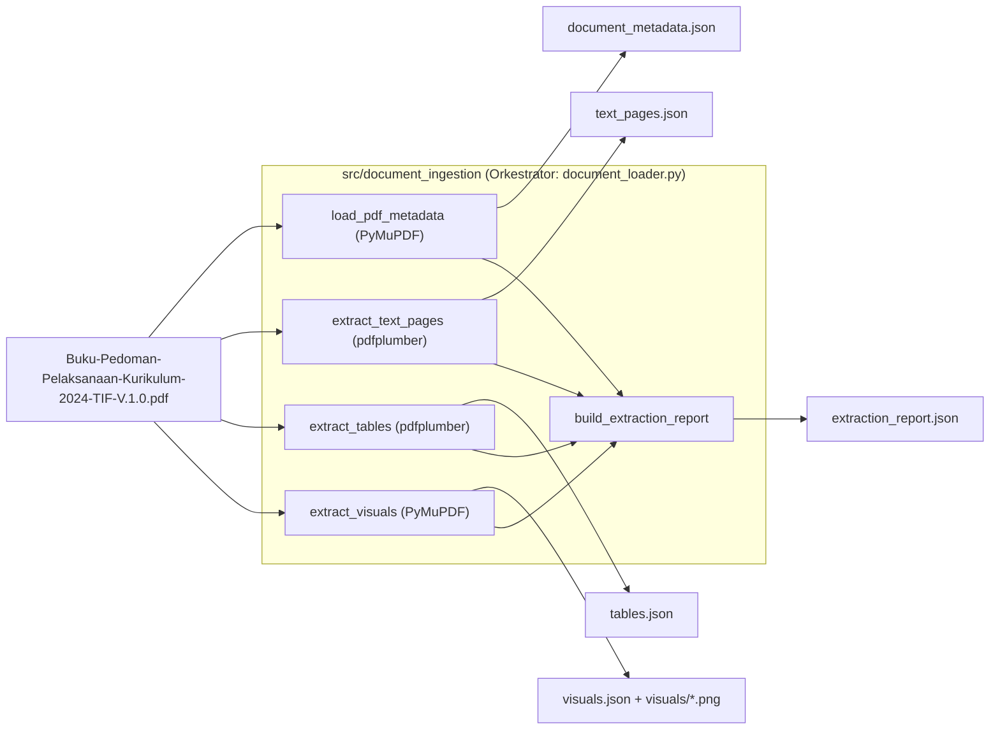
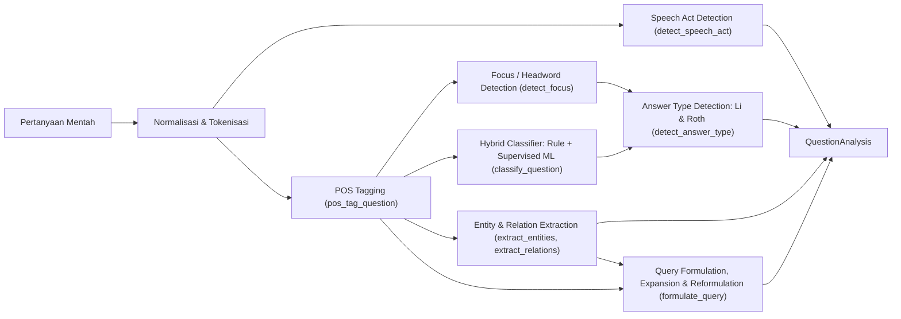
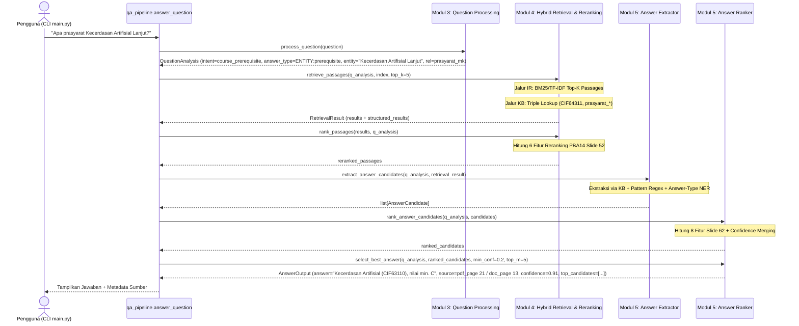

# System Architecture Document
## Sistem Question Answering Kurikulum 2024 Teknik Informatika Universitas Brawijaya

> **Versi Dokumen:** 1.0  
> **Tanggal:** 21 November 2026  
> **Mata Kuliah:** Pemrosesan Bahasa Alami (NLP) — Tugas Akhir (Topik 1: *Question Answering Sederhana Tanpa LLM*)  
> **Korpus Utama:** *Buku Pedoman Pelaksanaan Kurikulum 2024 Teknik Informatika UB V.1.0* (100 halaman PDF)  
> **Single Source of Truth Kontrak Data:** [`src/contracts.py`](../src/contracts.py) | **Konfigurasi:** [`config/settings.py`](../config/settings.py)

---

## 1. Ringkasan Eksekutif & Prinsip Arsitektur

Dokumen ini mendefinisikan arsitektur sistem **Question Answering (QA) Kurikulum 2024 Program Studi Teknik Informatika Universitas Brawijaya**. Sistem dirancang untuk menjawab pertanyaan faktual dan prosedural pengguna secara akurat berdasarkan korpus resmi pedoman kurikulum, lengkap dengan bukti rujukan halaman (`pdf_page`, `doc_page`), bagian dokumen (`section`), atau judul tabel (`table_title`).

### 1.1 Paradigma Arsitektur: Hybrid QA (IR-Based + Structured KB-QA)

Mengacu pada materi perkuliahan **PBA14 (Question Answering System)**, sistem mengadopsi pola **Hybrid Question Answering** (ala IBM Watson, PBA14 Slide 75) yang memadukan dua cabang secara deterministik **tanpa menggunakan Large Language Model (LLM)**:

1. **Cabang Information Retrieval (IR-Based QA):** Menjawab pertanyaan berbasis teks naratif, definisi, deskripsi silabus, dan aturan peralihan melalui pemrosesan pertanyaan (NLP klasik), pencarian *passage* (BM25 / TF-IDF), pemeringkatan ulang 6 fitur (*Passage Reranking*), serta ekstraksi kandidat jawaban berbasis *Answer-Type NER* dan *Pattern Regex*.
2. **Cabang Structured Knowledge Base (KB-QA):** Menjawab pertanyaan faktual terstruktur (kode MK, jumlah SKS, semester, prasyarat, praktikum, pemetaan CPL, daftar MK *Learning Path*, dan tabel konversi kurikulum 2020–2024) melalui *Knowledge Triples* `(subject, predicate, object)` yang dibangun dari hasil ekstraksi tabel dan transkripsi visual terverifikasi.

Kedua cabang digabungkan pada tahap **Candidate Answer Ranking & Confidence Merging** (8 fitur PBA14 Slide 62) untuk menghasilkan jawaban terbaik beserta daftar `top_candidates` guna perhitungan metrik **Accuracy** dan **Mean Reciprocal Rank (MRR)**.

### 1.2 Prinsip & Batasan Teknis

| Prinsip | Ketentuan Implementasi |
|---|---|
| **Zero-LLM Policy** | Seluruh tahapan (ekstraksi, pemrosesan pertanyaan, retrieval, reranking, dan ekstraksi jawaban) menggunakan Classic NLP, IR, regex/aturan, dan *supervised ML* klasik (`scikit-learn` / `CRF`). |
| **Dual Pagination Integrity** | Setiap artefak data wajib menyimpan `pdf_page` (indeks 1–100 PDF) **dan** `doc_page` (nomor halaman tercetak pada footer `i`–`vi`, `1`–`92`) untuk mengatasi anomali duplikasi halaman `6` di dokumen asli. |
| **Evidence Grounding & Fallback** | Jawaban wajib bersumber dari korpus. Jika tidak ada kandidat yang melampaui ambang batas (`MIN_CONFIDENCE_THRESHOLD = 0.2`), sistem mengembalikan `status = "not_found"` alih-alih menebak. |
| **Kontrak Data Terpusat** | Komunikasi antar-5 modul dikunci melalui `TypedDict` pada `src/contracts.py` sehingga kelima anggota dapat bekerja paralel tanpa konflik integrasi. |
| **Portabilitas Path** | Seluruh akses berkas menggunakan path relatif terpusat melalui `config/settings.py`. |
| **Transparansi Visual** | Konten visual diinventarisasi secara eksplisit; hanya 11 diagram prioritas tinggi (*Gambar 7.1–7.11 Learning Path*) yang ditranskripsi terstruktur secara terverifikasi, tanpa klaim palsu atas diagram lain. |

### 1.3 Status Implementasi Modul Terkini

| Modul | Folder | Owner | Status Saat Ini | Artefak Utama |
|---|---|---|---|---|
| **Modul 1: Document Ingestion** | `src/document_ingestion/` | Mas Syafiq | **Implemented & Verified** | `document_metadata.json`, `text_pages.json`, `tables.json`, `visuals.json`, `extraction_report.json`, 16 PNG di `data/extracted/visuals/` |
| **Modul 2: Preprocessing & Structuring** | `src/preprocessing/` | Radit | **Contract & Skeleton Ready** | Target: `data/processed/passages.jsonl`, `knowledge_triples.jsonl` |
| **Modul 3: Question Processing** | `src/question_processing/` | Yusuf | **Contract & Skeleton Ready** | Target: `QuestionAnalysis` (POS, Speech Act, Hybrid Classifier, Li & Roth, Focus, Entity/Relation, Query Expansion) |
| **Modul 4: Hybrid Retrieval & Reranking** | `src/retrieval/` | Azza Arsyada | **Contract & Skeleton Ready** | Target: Indeks BM25/TF-IDF + KB Lookup, `RetrievalResult` (6 fitur reranking) |
| **Modul 5: Answer Processing & Pipeline** | `src/answer_processing/`, `src/pipeline/` | Zulfan | **Contract & Skeleton Ready** | Target: `AnswerOutput`, integrasi `main.py`, evaluasi 20 soal (`evaluation_results.csv`) |

---

## 2. Arsitektur Tingkat Tinggi (High-Level Architecture)

Arsitektur sistem terbagi menjadi **tiga alur kerja utama**:
1. **Offline Data & Indexing Pipeline** — mengubah PDF mentah menjadi korpus *passage* bersih, *knowledge triples*, dan indeks pencarian.
2. **Online Question Answering Pipeline** — memproses pertanyaan pengguna secara *real-time* melalui kedua cabang (IR + KB) hingga menghasilkan jawaban berujukan.
3. **Evaluation Pipeline** — menguji performa sistem secara otomatis terhadap 20 pertanyaan *ground truth* dengan metrik Accuracy dan MRR.



---

## 3. Pemetaan Materi Perkuliahan NLP (PBA14) ke Arsitektur

Untuk memenuhi ketentuan tugas akhir (`soal.md`) agar sistem menerapkan materi NLP perkuliahan secara nyata (bukan sekadar pencarian kata kunci biasa), tabel berikut memetakan tiap teknik NLP ke modul dan fungsi spesifik:

| Materi / Teknik NLP | Referensi PBA14 | Modul & File | Peran dalam Sistem |
|---|---|---|---|
| **Layout-Aware Document Parsing** | Pra-korpus PDF | `src/document_ingestion/` | Ekstraksi teks non-tabel, 5 tipe tabel lintas halaman, dan transkripsi visual ber-metadata |
| **Text Cleaning & Normalization** | Text Preprocessing | `src/preprocessing/preprocessing.py` | Pembersihan artefak PDF/silabus, konversi simbol `✓`, *case folding* selektif |
| **Domain-Aware Tokenization** | Tokenization | `src/preprocessing/preprocessing.py` | Mempertahankan kode MK (`CIF63110`, `MPK60001-5`), kode CPL (`IF_CPL_S1`), angka SKS/semester |
| **Selective Stopword & Stemming** | Stopword & Stemming | `src/preprocessing/preprocessing.py` | Stopword selektif & stemming `Sastrawi` ke `stemmed_text` tanpa merusak teks tampilan (`text`) |
| **POS Tagging Bahasa Indonesia** | POS Tagging (Slide 46) | `src/question_processing/query_formulator.py` | Pelabelan kelas kata pertanyaan untuk fitur klasifikasi, deteksi *focus*, & ekstraksi frasa |
| **Speech Act & Hybrid Question Classification** | Slide 17, 43–45 | `src/question_processing/question_classifier.py` | Deteksi `wh`/`yes_no`/`command`/`indirect_request` + klasifikasi *intent* (Rule + Supervised ML) |
| **Answer Type Detection (Li & Roth)** | Slide 39–42 | `src/question_processing/answer_type_detector.py` | Pemetaan 6 kelas kasar + subkelas domain kurikulum |
| **Focus / Headword Detection** | Slide 36, 44 | `src/question_processing/entity_extractor.py` | Ekstraksi frasa inti (*headword*) yang akan digantikan oleh jawaban |
| **Entity & Relation Extraction** | NER & IE (Slide 35, 37, 69) | `src/question_processing/entity_extractor.py` | Ekstraksi entitas kurikulum & relasi `(predicate, subject, object)` untuk query KB |
| **Query Expansion & Reformulation** | Slide 47 (Lin 2007) | `src/question_processing/query_formulator.py` | Ekspansi sinonim/akronim domain (`MK`, `AI`, `CPL`, `MBKM`) & reformulasi deklaratif |
| **Classic IR (BM25 & TF-IDF)** | IR-Based QA (Slide 48–50) | `src/retrieval/index_builder.py`, `retriever.py` | Pengindeksan & pemeringkatan awal top-K *passage* (dibandingkan BM25 vs TF-IDF) |
| **Passage Reranking (6 Fitur)** | Slide 51–52 | `src/retrieval/ranking.py` | Pemeringkatan ulang kandidat *passage* berbasis *answer type* dan kedekatan kata kunci |
| **Answer-Type NER & Pattern Regex** | Slide 55–58 | `src/answer_processing/answer_extractor.py` | Ekstraksi kandidat jawaban *factoid* & pola `<QP>/<AP>` dari teks/tabel |
| **Structured Knowledge Base QA** | Slide 66–75 | `passage_builder.py`, `retriever.py`, `answer_extractor.py` | Pembangunan & penelusuran triple `(subject, predicate, object)` |
| **Candidate Ranking (8 Fitur) & Merging** | Slide 62 | `src/answer_processing/answer_ranker.py` | Pemeringkatan kandidat akhir termasuk *novelty factor*, *apposition*, & penggabungan skor |
| **QA Evaluation Metrics** | Slide 64 | `src/pipeline/evaluation.py` | Perhitungan **Accuracy** (Rank-1) dan **Mean Reciprocal Rank (MRR)** pada Top-M kandidat |

---

## 4. Arsitektur Detail per Modul

### 4.1 Modul 1 — Document Ingestion (`src/document_ingestion/`) — *Implemented*

**Owner:** Mas Syafiq  
**Tujuan:** Mengonversi PDF pedoman kurikulum (100 halaman) menjadi empat berkas JSON terstruktur plus aset visual PNG dan laporan kualitas ekstraksi secara deterministik.

#### Diagram Internal Modul 1



#### Rincian Teknis Komponen yang Sudah Diimplementasikan

1. **`document_loader.py` (Inspeksi Metadata, Orkestrator & Pelaporan Kualitas)**
   - `load_pdf_metadata()`: Membuka PDF via `pymupdf` (`fitz`), membaca dimensi & orientasi tiap halaman (`portrait` vs `landscape`), menghitung jumlah karakter, gambar tertanam, dan *drawing paths*, mendeteksi `doc_page` pada area footer (`FOOTER_HEIGHT_PT = 68.0`), serta membangun peta rentang bab (`detected_sections`).
   - `run_full_ingestion()`: Menjalankan keseluruhan pipeline secara berurutan (`load_pdf_metadata` -> `extract_text_pages` -> `extract_tables` -> `extract_visuals` -> `build_extraction_report`) dengan CLI `--pdf`, `--output-dir`, dan `--metadata-only`.
   - `build_extraction_report()`: Mengaudit kualitas ekstraksi secara otomatis, mencakup:
     - Deteksi duplikasi `doc_page` lintas `pdf_page` (terdeteksi `doc_page="6"` pada `pdf_page` 13 dan 14).
     - Agregasi `quality_flags` tabel (`empty_records`, `syllabus_template_artifact`, `empty_cpl_reference`, `unexpected_cpl_column_count`).
     - Agregasi catatan perbedaan angka SKS antara diagram visual Learning Path dan tabel Bab 7 (`visual_vs_table_sks_discrepancy`).

2. **`extract_text.py` (Ekstraksi Teks Naratif Non-Tabel)**
   - **Pemisahan Footer & Badan Halaman:** Memotong area bawah setinggi `FOOTER_HEIGHT_PT = 68.0` pt (terverifikasi aman untuk halaman *portrait* 842 pt maupun *landscape* 595 pt) guna mengekstrak `doc_page` (Romawi `i–vi` atau Arab `1–92`) secara terpisah dari teks isi.
   - **State Machine Pelacakan Bab & Subbab (`_update_section_state`):**
     - Halaman 1 ditetapkan sebagai `"Sampul"`; halaman 2–7 dipetakan ke *front matter* (`Kata Pengantar`, `Versi dan Revisi`, `Daftar Isi`, `Daftar Tabel`, `Daftar Gambar`, `Tim Penyusun Kurikulum`).
     - Deteksi Bab utama 1–11 menggunakan verifikasi urut (`chap_num == current_chapter + 1`) agar tidak tertukar dengan daftar bernomor di dalam paragraf (mis. `"3. IISMA"`), serta menggabungkan judul bab 2 baris (*wrapped all-caps heading*, mis. Bab 9).
     - Mendukung subbab bernomor (`7.1`, `8.2`, `9.1`) serta subbab berhuruf di Bab 1 (`A–D`) dan Bab 7 (`A–K. Learning Path ...`).
   - **Eksklusi Bounding Box Tabel (`exclude_tables=True`):** Mendeteksi *bounding box* tabel bergaris (`vertical_strategy="lines"`, `horizontal_strategy="lines"`) lalu memfilter objek karakter dengan margin `TABLE_BBOX_MARGIN_PT = 1.5` pt agar teks tabel tidak terduplikasi pada field `text` dan `paragraphs` (teks lengkap tetap dipertahankan di `raw_text` untuk audit).
   - **Segmentasi Paragraf (`_extract_paragraphs`):** Mengelompokkan kata ke baris berdasarkan koordinat vertikal `top` (toleransi `3.5` pt) dan memisahkan blok paragraf jika jarak vertikal antar-baris melebihi `max(height * 0.75, 7.0)` pt atau bertemu *heading* / butir daftar.

3. **`extract_tables.py` (Parser Khusus 5 Kategori Tabel Kurikulum)**
   - Menggunakan strategi deteksi garis `pdfplumber` (`snap_tolerance=3`, `join_tolerance=3`), deteksi *caption* tepat di atas tabel (`_detect_caption_above` hingga 45 pt ke atas), perbaikan pemenggalan kode MK (mis. `"MPK60001- 5"` -> `"MPK60001-5"`), dan pelacakan lanjutan lintas halaman (`is_continuation`, `continuation_of`).
   - Mengimplementasikan **5 parser khusus** sesuai struktur aktual PDF:
     1. **`regular` (17 blok):** Tabel Versi Dokumen, Tabel 3.1 (CPL dengan pewarisan kategori `A–D` lintas halaman dan penggabungan deskripsi terpecah), Tabel 6.1–6.4, 7.1–7.4 (mempertahankan syarat `">60"` SKS), 9.9–9.10, dan Tabel 10.1 (MBKM lintas 4 halaman). Dilengkapi algoritma **`_collapse_padded_grid()`** berbasis *horizontal X-overlap* untuk menyusutkan kolom *spacer/padding* hasil ekspor MS Word.
     2. **`cpl_matrix` (3 blok — Tabel 4.1):** Menggabungkan header kode CPL 2 baris (`IF_CPL` + `_S1`) dan memetakan tanda centang `✓` ke 10 kode CPL menggunakan penyelarasan titik tengah sumbu X (`cpl_codes`, `cpl_count`).
     3. **`semester_schedule` (11 blok — Semester 1–8, Semester Antara A/B, Tabel 9.11):** Mengekstrak 8 kolom standar (`No`, `Kode MK`, `Nama MK`, `SKS`, `Praktikum` boolean, `Prasyarat_Kode`, `Prasyarat_MK`, `Prasyarat_Nilai`), menggabungkan baris multi-prasyarat untuk satu MK, dan menangkap `total_sks`.
     4. **`transition_mapping` (9 blok — Tabel 9.1–9.8):** Memetakan pasangan `Kurikulum Lama (2020)` vs `Kurikulum Baru (2024)`, membuang kolom kosong (mis. Tabel 9.8), dan menggabungkan pecahan nama MK lintas baris.
     5. **`syllabus_card` (109 blok — Bab 11, 66 MK unik):** Memecah kartu silabus menjadi `kode_mk`, `nama_mk`, `sks`, `deskripsi`, `bahan_kajian` (daftar butir bernomor), dan `cpmk` (`kode`, `deskripsi`, daftar kode `IF_CPL_*`). Mendeteksi lanjutan kartu silabus lintas halaman berdasarkan kecocokan `course_code` dan memberi flag `syllabus_template_artifact` serta `empty_cpl_reference`.

4. **`extract_visuals.py` (Inventarisasi Visual & Transkripsi Terstruktur)**
   - Mengekspor 16 gambar tertanam non-sampul dari PDF via `pymupdf` ke `data/extracted/visuals/` dengan penamaan seragam (`page_025_gambar_7_1.png`, dst.) dan path relatif POSIX agar portabel antar-OS.
   - Mengelompokkan visual ke tiga tingkat penanganan:
     - **Prioritas Tinggi (`Gambar 7.1–7.11`, 11 diagram Learning Path):** Menggunakan `extraction_method = "structured_transcription"` yang diverifikasi manual (`LEARNING_PATH_TRANSCRIPTIONS`), menghasilkan baik `text` naratif kaya kata kunci untuk BM25/TF-IDF maupun `structured_records` (`learning_path`, `group`, `course_name`, `sks`, `notes`) untuk pembangunan *Knowledge Triples*.
     - **Prioritas Sedang/Rendah (`Gambar 3.1, 5.1, 8.1–8.3`, 5 diagram):** Menggunakan `extraction_method = "inventory_summary"` dengan ringkasan metadata (`NON_LP_VISUAL_METADATA`), transparan bahwa isi grafis alur tidak diklaim diekstrak penuh.

#### Metrik Ekstraksi Aktual Terverifikasi (`data/extracted/extraction_report.json`)

| Metrik Ekstraksi | Nilai Terverifikasi | Keterangan |
|---|---|---|
| Total halaman PDF | **100** (97 portrait, 3 landscape) | 9.19 MB, PDF 1.4, tanpa *embedded TOC* |
| Halaman berisi konten (teks/tabel) | **99** | Halaman 1 adalah sampul gambar penuh |
| Halaman dengan teks naratif non-kosong | **41** | Setelah eksklusi bounding box tabel |
| Total blok tabel diekstrak | **149** (49 blok lanjutan) | 17 `regular`, 3 `cpl_matrix`, 11 `semester_schedule`, 9 `transition_mapping`, 109 `syllabus_card` |
| Mata kuliah silabus unik (Bab 11) | **66 MK** | Tersebar di halaman PDF 50–100 |
| Visual diinventarisasi | **16 gambar** | 11 *Learning Path* ditranskripsi penuh, 5 inventarisasi ringkas |
| Peringatan kualitas tercatat | **15 warnings** | 1 duplikasi `doc_page`, 10 artefak silabus/CPL kosong, 4 perbedaan SKS visual vs tabel |
| Item gagal ekstraksi (`failed_count`) | **0** | Seluruh unit test di `tests/test_ingestion.py` memverifikasi skema & konten kunci |

---

### 4.2 Modul 2 — Text Preprocessing, Structuring & Knowledge Base (`src/preprocessing/`)

**Owner:** Radit  
**Input:** `data/extracted/text_pages.json`, `tables.json`, `visuals.json`  
**Output:** `data/processed/passages.jsonl` (`list[PassageRecord]`), `data/processed/knowledge_triples.jsonl` (`list[KnowledgeTriple]`), dan laporan validasi korpus.

#### Komponen & Tanggung Jawab

1. **`preprocessing.py` (Pipeline Normalisasi Teks Classic NLP)**
   - `clean_text(raw_text)`: Menghapus artefak PDF tersisa, baris template silabus rusak (`CPMK-1 (%): CPMK-2 (%) ...`), spasi ganda, dan pemenggalan kata antar-baris.
   - `normalize_text(text)`: Melakukan *case folding* selektif, normalisasi tanda baca dan operator syarat (`>= 60 SKS`, `>60`), serta mempertahankan format sensitif domain.
   - `tokenize_text(text)`: Tokenisasi berbasis regex/NLTK yang **tidak memecah** entitas struktural seperti kode MK (`CIF63110`, `MPK60001-5`), kode CPL (`IF_CPL_KK3`), nomor tabel (`Tabel 7.1`), dan nilai huruf/angka SKS.
   - `remove_stopwords(tokens)`: Penghapusan *stopword* Bahasa Indonesia secara selektif (wajib mempertahankan kata negasi seperti *tidak*, *bukan*, *minimal*, *maksimal*, kata penanda syarat seperti *wajib*, *pilihan*, *prasyarat*, serta seluruh angka & kode).
   - `stem_text(tokens)`: Stemming Bahasa Indonesia memakai `Sastrawi` hanya untuk mengisi field **`stemmed_text`** (keperluan *recall* pada indexing BM25/TF-IDF). Field **`text`** asli dipertahankan utuh agar modul *Answer Extraction* tidak mengembalikan kata terpotong.

2. **`passage_builder.py` (Dual Output: IR Passages + KB Triples)**
   - **`build_passages(extracted_items)`:**
     - **Dari `text_pages.json`:** Mengubah `paragraphs` non-kosong (mengabaikan halaman *front matter* indeks seperti Daftar Isi/Tabel/Gambar) menjadi unit `PassageRecord` (`content_type="text"`) dengan penggabungan konteks `section` dan `subsection`.
     - **Dari `tables.json`:** Menggabungkan blok tabel yang memiliki `is_continuation=True` ke tabel induknya (`continuation_of`) — termasuk menggabungkan 109 blok `syllabus_card` menjadi **66 kartu silabus utuh**. Setiap record tabel diubah menjadi kalimat terstruktur eksplisit (mis. mengubah `praktikum: true` menjadi `"Praktikum: Ya"`, memetakan `cpl_codes` menjadi daftar kode CPL pada Tabel 4.1) sehingga kaya konteks saat diindeks.
     - **Dari `visuals.json`:** Memasukkan 11 visual `structured_transcription` (`Gambar 7.1–7.11`) dan ringkasan visual relevan (`Gambar 8.1–8.3`) sebagai `PassageRecord` (`content_type="visual"`).
   - **`build_knowledge_triples(extracted_items)`:**
     - Mengekstrak fakta atomik `KnowledgeTriple` `(subject, predicate, object)` beserta provenance (`pdf_page`, `doc_page`, `section`, `table_title`, `content_type`).
     - **Katalog Predikat Standar Domain Kurikulum:**
       - Dari `semester_schedule`: `nama_mk`, `sks`, `semester`, `praktikum`, `prasyarat_kode`, `prasyarat_mk`, `prasyarat_nilai`, `total_sks_semester`.
       - Dari `regular` (Tabel 3.1, 6.1–6.4, 7.1–7.4, 10.1): `deskripsi_cpl`, `kategori_cpl`, `kelompok_mk_pilihan`, `syarat_sks_minimal`, `komposisi_sks_prodi`.
       - Dari `cpl_matrix` (Tabel 4.1): `mendukung_cpl`.
       - Dari `transition_mapping` (Tabel 9.1–9.8): `ekuivalensi_kurikulum_baru`, `ekuivalensi_kurikulum_lama`, `perubahan_sks`.
       - Dari `syllabus_card` (Bab 11): `deskripsi_mk`, `bahan_kajian`, `cpmk`, `cpmk_cpl`.
       - Dari `visuals` (Gambar 7.1–7.11): `learning_path_course`, `learning_path_group`, `learning_path_sks`.

3. **`corpus_validator.py` (`validate_corpus`)**
   - Memverifikasi 0 *passage* kosong, deteksi duplikat `passage_id`/`text`, kelengkapan metadata (`pdf_page`, `doc_page`, `section`), distribusi `content_type` (`text`/`table`/`visual`), serta integritas triple (tidak ada `subject`/`predicate` kosong).

---

### 4.3 Modul 3 — Question Processing & NLP Analysis (`src/question_processing/`)

**Owner:** Yusuf  
**Input:** String pertanyaan pengguna (`question: str`)  
**Output:** `QuestionAnalysis` (`src/contracts.py`)

#### Alur Internal Modul 3



#### Rincian Sub-Komponen

1. **`query_formulator.py` (`pos_tag_question`, `formulate_query`)**
   - **POS Tagging Bahasa Indonesia:** Menggunakan CRF (`python-crfsuite`) atau NLTK/rule-based *tagger* dengan kamus istilah domain kurikulum (`SKS`, `CPL`, `MBKM`, `prasyarat`, kode MK sebagai `NNP`/`CD`).
   - **Query Formulation & Expansion:**
     - Memilih kata kunci informatif (`query_keywords`) dengan membuang kata tanya dan *stopword* non-esensial.
     - Memperluas kueri (`expanded_queries`) dengan kamus sinonim/akronim domain: `MK <-> mata kuliah`, `AI <-> kecerdasan artifisial`, `NLP <-> pemrosesan bahasa alami`, `PL <-> perangkat lunak`, `syarat <-> prasyarat`, `transisi <-> peralihan`, `LP <-> learning path`.
     - Melakukan **Declarative Query Reformulation** (ala Lin 2007, PBA14 Slide 47), misalnya *"Apa prasyarat Kecerdasan Artifisial Lanjut?"* -> *"prasyarat kecerdasan artifisial lanjut adalah ..."*.

2. **`question_classifier.py` (`detect_speech_act`, `classify_question`, `train_question_classifier`)**
   - **Speech Act Detection (PBA14 Slide 17):** Mengklasifikasikan tindak tutur ke `wh` (*apa, berapa, siapa, bagaimana, mana*), `yes_no` (*apakah, bolehkah, wajibkah*), `command` (*sebutkan, jelaskan, tampilkan*), atau `indirect_request` (*saya ingin tahu..., bisakah menyebutkan...*).
   - **Hybrid Question Classification (PBA14 Slide 43–45):**
     - Lapis pertama: aturan regex/pola deterministik berpresisi tinggi untuk intent domain (`course_prerequisite`, `course_sks`, `semester_courses`, `learning_path`, `transition_rule`, `cpl_mapping`, `course_syllabus`, `mbkm_activity`, `definition`).
     - Lapis kedua: *Supervised ML* klasik (`scikit-learn` `LinearSVC` / `LogisticRegression` / `MultinomialNB`) dilatih pada dataset pertanyaan beranotasi menggunakan fitur n-gram kata, urutan POS tag, dan *question headword* untuk menangani variasi parafrase pengguna.
     - Menghasilkan `(intent, question_category)` dengan `question_category` ∈ `{factoid, definition, list, narrative, yes_no}`.

3. **`entity_extractor.py` (`extract_entities`, `detect_focus`, `extract_relations`)**
   - **Entity Extraction:** Mengenali entitas domain kurikulum via kombinasi regex dan *gazetteer* (dibangun dari korpus Kurikulum 2024):
     - `course_code`: pola `[A-Z]{3}\d{5}(?:-\d+)?` (mis. `CIF64311`, `MPK60001-5`, `COM60014`, `UBU60001`).
     - `course_name`: pencocokan leksikon nama 66+ MK & alias (`AI Lanjut`, `PBA`, `MLOps`).
     - `semester`: `semester [1-8]` atau `semester antara`.
     - `cpl_code`: `IF_CPL_(S|P|KU|KK)\d+`.
     - `learning_path`: 11 nama jalur (*Frontend Developer*, *Backend Developer*, *AI/ML Engineer*, *NLP Engineer*, dst.).
     - `competency_group`: *Perekayasa Perangkat Lunak*, *Perekayasa Infrastruktur Komputasi*, *Perekayasa Komputasi Cerdas*.
   - **Focus Detection (Slide 36 & 44):** Mengidentifikasi *headword* (frasa nomina tepat setelah kata tanya, mis. `"prasyarat"`, `"total SKS"`, `"mata kuliah wajib"`).
   - **Relation Extraction (Slide 35, 37, 69):** Memetakan pasangan entitas dan intent ke `ExtractedRelation`, misalnya `{"predicate": "prasyarat_mk", "subject": "Kecerdasan Artifisial Lanjut", "object": null}` untuk dieksekusi oleh cabang KB-QA.

4. **`answer_type_detector.py` (`detect_answer_type`)**
   - Memetakan pertanyaan ke **Taksonomi Li & Roth (2005)** (6 kelas umum + subkelas spesifik kurikulum):

| Coarse Class (`answer_type_coarse`) | Fine Class (`answer_type`) | Contoh Pertanyaan Kurikulum |
|---|---|---|
| `NUMERIC` | `NUMERIC:count`, `NUMERIC:period`, `NUMERIC:grade` | *"Berapa total SKS muatan prodi?"*, *"Semester berapa MK AI?"*, *"Nilai minimal prasyarat?"* |
| `ENTITY` | `ENTITY:course_code`, `ENTITY:course_name`, `ENTITY:course_list`, `ENTITY:prerequisite`, `ENTITY:cpl`, `ENTITY:learning_path` | *"Apa prasyarat KA Lanjut?"*, *"Apa saja MK wajib semester 3?"*, *"MK pilihan Learning Path NLP?"* |
| `DESCRIPTION` | `DESCRIPTION:definition`, `DESCRIPTION:reason`, `DESCRIPTION:procedure` | *"Apa perbedaan aturan peralihan sem 3 & 5?"*, *"Jelaskan visi Prodi TIF"* |
| `ABBREVIATION` | `ABBREVIATION:exp` | *"Apa kepanjangan CPL / MBKM?"* |
| `HUMAN` | `HUMAN:group` | *"Siapa tim penyusun kurikulum?"*, *"Bagaimana profil lulusan?"* |
| `LOCATION` | `LOCATION:other` | *"Di fakultas/unit mana kegiatan MBKM dilaksanakan?"* |

---

### 4.4 Modul 4 — Hybrid Retrieval & Passage Reranking (`src/retrieval/`)

**Owner:** Azza Arsyada  
**Input:** `passages.jsonl`, `knowledge_triples.jsonl` (offline); `QuestionAnalysis` (online)  
**Output:** `RetrievalResult` berisi `results` (`list[RetrievedPassage]` berperingkat) dan `structured_results` (`list[KnowledgeTriple]`).

#### Komponen & Algoritma

1. **`index_builder.py` (`build_index`)**
   - **IR Index (Dual-Method Support untuk Eksperimen):**
     - **BM25 (`rank_bm25.BM25Okapi`):** Diindeks menggunakan token yang dinormalisasi & di-*stem* (`tokens` + `stemmed_text`), ideal untuk menangani panjang *passage* yang sangat bervariasi (antara 1 baris tabel pendek hingga silabus panjang).
     - **TF-IDF Cosine Similarity (`scikit-learn` `TfidfVectorizer`):** Disediakan sebagai *baseline* pembanding pada Bab V untuk mengevaluasi keunggulan BM25 secara kuantitatif (Recall@K & Retrieval MRR).
     - Tokenizer kustom memastikan kode MK (`cif64311`), kode CPL (`if_cpl_s1`), dan angka semester/SKS tidak terbuang.
   - **KB Triple Index:** Kamus indeks terbalik (*inverted dictionary*) untuk `knowledge_triples.jsonl` berdasarkan `subject` (kode MK, nama MK ternormalisasi, nama *learning path*, semester) dan `predicate`, dilengkapi pemetaan alias nama MK <-> kode MK.

2. **`retriever.py` (`retrieve_passages`, `retrieve_triples`)**
   - **IR Retrieval:** Menggabungkan skor pencarian dari `query_keywords` dan `expanded_queries`, lalu mengambil kandidat awal (misalnya `top_n = max(top_k * 3, 15)`) agar tahap reranking memiliki ruang seleksi memadai. Mendukung *exact-match boosting* ketika kode MK atau nama MK muncul persis di *passage*.
   - **Relation Retrieval (`retrieve_triples`):** Mencocokkan `entities` dan `relations` dari `QuestionAnalysis` terhadap indeks KB. Contoh: relasi `prasyarat_mk` pada subjek `"Kecerdasan Artifisial Lanjut"` (alias `CIF64311`) langsung mengembalikan triple `("CIF64311", "prasyarat_mk", "Kecerdasan Artifisial")` dan `("CIF64311", "prasyarat_nilai", "C")` beserta `pdf_page=21, doc_page="13"`.

3. **`ranking.py` (Passage Reranking — 6 Fitur PBA14 Slide 52)**
   - Menghitung vektor 6 fitur (`extract_passage_ranking_features`) untuk setiap kandidat *passage*, lalu menggabungkannya dengan skor awal BM25/TF-IDF menjadi `rerank_score` dan memotong ke `top_k` (`DEFAULT_TOP_K = 5`):

| # | Nama Fitur (`rerank_features`) | Definisi Operasional |
|---|---|---|
| 1 | `answer_type_ne_count` | Jumlah entitas pada *passage* yang cocok dengan `answer_type` yang diharapkan (mis. pola angka SKS untuk `NUMERIC:count`, kode/nama MK untuk `ENTITY:prerequisite`). |
| 2 | `keyword_match_count` | Jumlah *query keywords* unik yang ditemukan dalam *passage*. |
| 3 | `longest_keyword_seq` | Panjang rangkaian kata kunci pertanyaan terpanjang yang muncul berurutan (*longest contiguous sequence*). |
| 4 | `source_doc_rank` | Skor invers dari peringkat awal retrieval (`1 / doc_rank`). |
| 5 | `keyword_proximity` | Skor kedekatan (invers jarak token rata-rata/minimum) antar kata kunci query di dalam *passage*. |
| 6 | `ngram_overlap` | Proporsi *bigram* dan *trigram overlap* antara pertanyaan dan *passage*. |

---

### 4.5 Modul 5 — Answer Processing, Orchestration & Evaluation (`src/answer_processing/`, `src/pipeline/`)

**Owner:** Zulfan  
**Input:** `QuestionAnalysis`, `RetrievalResult`  
**Output:** `AnswerOutput` (termasuk `answer`, `source`, `confidence`, `status`, dan `top_candidates` hingga `DEFAULT_ANSWER_TOP_M = 5`).

#### 3 Jalur Answer Extraction (`answer_extractor.py`)

1. **Jalur 1 — Structured Knowledge Base Extraction (PBA14 Slide 66–75):**
   - Mengonversi `retrieval_result["structured_results"]` menjadi `AnswerCandidate` dengan `extraction_method = "knowledge_base"`.
   - Untuk pertanyaan bertipe `list` (mis. daftar MK semester 3 atau MK *Learning Path* NLP), menggabungkan beberapa triple berpredikat sama menjadi satu kandidat agregat yang rapi sekaligus mempertahankan metadata sumber.
2. **Jalur 2 — Answer-Type Pattern Extraction `<QP>/<AP>` (PBA14 Slide 57–58):**
   - Menerapkan pola regex spesifik *answer type* dan *question intent* pada teks *passage* teratas (`extraction_method = "pattern_regex"`).
   - Contoh pola: ekstraksi nilai `Prasyarat: <AP> (nilai minimal <AP>)`, definisi `<QP> adalah <AP>`, jumlah `<AP> SKS`, dan poin aturan peralihan bernomor.
3. **Jalur 3 — Answer-Type Named Entity Tagger (PBA14 Slide 55–56):**
   - Memindai kandidat entitas sesuai `answer_type` (angka SKS, kode MK, nama MK, kode CPL, nilai huruf) pada kalimat terbaik dalam *passage* (`extraction_method = "ner_tagger"`).
4. **Passage Fallback (`extraction_method = "passage_fallback"`):**
   - Khusus pertanyaan deskriptif/naratif panjang (`DESCRIPTION:definition`, `DESCRIPTION:reason`), mengekstrak 1–3 kalimat paling relevan (*answer_granularity = "long"*) agar jawaban tetap setia pada teks (*faithful*).

#### Candidate Answer Ranking & Confidence Merging (`answer_ranker.py`)

Setiap `AnswerCandidate` dievaluasi menggunakan **8 fitur pemeringkatan PBA14 Slide 62**:

| # | Fitur (`features`) | Deskripsi |
|---|---|---|
| 1 | `answer_type_match` | Kecocokan tipe kandidat dengan `answer_type` / `answer_type_coarse`. |
| 2 | `pattern_match` | Apakah kandidat diekstrak melalui pola regex `<QP>/<AP>` atau KB yang tepat. |
| 3 | `question_keywords` | Jumlah kata kunci pertanyaan yang muncul dalam jendela konteks kandidat. |
| 4 | `keyword_distance` | Kedekatan jarak token antara posisi kandidat dan kata kunci pertanyaan. |
| 5 | `novelty_factor` | **Faktor kebaruan:** bernilai tinggi jika kandidat **bukan** sekadar pengulangan frasa yang sudah ada di pertanyaan. |
| 6 | `apposition_feature` | Indikator struktur apositif terhadap entitas pertanyaan (mis. `"CIF63110 (Kecerdasan Artifisial)"`). |
| 7 | `punctuation_location` | Posisi tanda baca penegas di sekitar kandidat (titik dua, koma, tanda kurung, titik). |
| 8 | `question_term_seq` | Panjang rangkaian term pertanyaan terpanjang di sekitar kandidat. |

- **Confidence Merging:** Jika kandidat yang secara semantik/tekstual ekuivalen muncul dari beberapa jalur (mis. dari *Knowledge Base* **dan** terkonfirmasi oleh *Pattern Regex* pada *passage* IR), skor kepercayaannya digabungkan (*boosting*) sambil mempertahankan rujukan sumber paling spesifik.
- **Thresholding & Fallback (`select_best_answer`):**
  - Mengurutkan kandidat berdasarkan skor akhir dan mengambil hingga `top_m = 5` sebagai `top_candidates` (wajib untuk perhitungan MRR).
  - Jika kandidat peringkat-1 memiliki `score < MIN_CONFIDENCE_THRESHOLD (0.2)` atau daftar kandidat kosong, sistem mengembalikan `status = "not_found"` dengan pesan bahwa dokumen tidak memiliki bukti yang cukup.

#### Sequence Diagram Alur End-to-End (`src/pipeline/qa_pipeline.py`)



---

## 5. Arsitektur Data & Kontrak Interface Antar-Modul

### 5.1 Aliran Artefak Data di Repository

```text
data/
├── raw/
│   └── Buku-Pedoman-Pelaksanaan-Kurikulum-2024-TIF-V.1.0.pdf   [Input Utama]
├── extracted/                                                   [Output Modul 1 — Tersedia]
│   ├── document_metadata.json    # Profil PDF, dimensi 100 hal., peta bab
│   ├── text_pages.json           # 100 hal. teks naratif non-tabel + paragraphs
│   ├── tables.json               # 149 blok tabel (5 kategori) + records & continuation
│   ├── visuals.json              # 16 inventaris visual + 11 transkripsi Learning Path
│   ├── extraction_report.json    # Audit kualitas & 15 peringatan anomali dokumen
│   └── visuals/*.png             # 16 berkas gambar diekspor via PyMuPDF
├── processed/                                                   [Output Modul 2 — Target]
│   ├── passages.jsonl            # Unit passage terstruktur (PassageRecord)
│   └── knowledge_triples.jsonl   # Fakta terstruktur (KnowledgeTriple)
└── evaluation/                                                  [Input Evaluasi]
    ├── questions_template.json   # Template skema evaluasi
    └── questions.json            # 20 pertanyaan ground truth (4/anggota)
```

### 5.2 Ringkasan Kontrak Data (`src/contracts.py`)

| Kontrak (`TypedDict`) | Produsen | Konsumen | Field Kunci |
|---|---|---|---|
| **Output Ekstraksi M1** (`text_pages.json`, `tables.json`, `visuals.json`) | Modul 1 | Modul 2 | `pdf_page`, `doc_page`, `section`, `content_type`, `text`/`paragraphs`, `table_type`, `is_continuation`, `continuation_of`, `records`, `structured_records`, `metadata` |
| **`PassageRecord`** | Modul 2 | Modul 4, 5 | `passage_id`, `text`, `stemmed_text`, `tokens`, `pdf_page`, `doc_page`, `section`, `content_type`, `table_title`, `metadata` |
| **`KnowledgeTriple`** | Modul 2 | Modul 4, 5 | `triple_id`, `subject`, `predicate`, `object`, `pdf_page`, `doc_page`, `section`, `table_title`, `content_type` |
| **`QuestionAnalysis`** | Modul 3 | Modul 4, 5 | `original_question`, `normalized_question`, `tokens`, `pos_tags`, `speech_act`, `question_category`, `intent`, `answer_type_coarse`, `answer_type`, `focus`, `query_keywords`, `expanded_queries`, `entities`, `relations` |
| **`RetrievalResult`** | Modul 4 | Modul 5 | `query`, `results: list[RetrievedPassage]` (termasuk `doc_rank`, `rerank_score`, `rerank_features`), `structured_results: list[KnowledgeTriple]` |
| **`AnswerCandidate` & `AnswerOutput`** | Modul 5 | CLI / Evaluasi | `question`, `answer`, `answer_granularity`, `source: AnswerSource`, `confidence`, `status`, `top_candidates: list[AnswerCandidate]` |

---

## 6. Strategi Penanganan *Edge Case* & Anomali Korpus

Berdasarkan eksplorasi korpus (`docs/corpus_exploration.md`) dan hasil audit Modul 1 (`data/extracted/extraction_report.json`), arsitektur merancang mitigasi spesifik terhadap 7 anomali nyata dokumen PDF:

| # | Anomali / *Edge Case* Dokumen | Lokasi pada PDF | Strategi Mitigasi Arsitektur |
|---|---|---|---|
| 1 | **Duplikasi nomor halaman tercetak (`doc_page="6"`)** dan offset halaman sampul/Romawi | `pdf_page` 13 (Tabel 3.1) & 14 (Bab 4) | **Modul 1–5:** Menyimpan **kedua** nomor (`pdf_page` & `doc_page`) di setiap artefak dan `AnswerSource`. |
| 2 | **Tabel & kartu silabus terpotong lintas halaman** (49 blok lanjutan) | Tabel 3.1, 4.1, 9.2–9.4, 10.1, dan Bab 11 (hal. 50–100) | **Modul 1:** Menandai `is_continuation` & `continuation_of`. **Modul 2:** Menggabungkan baris/record ke unit induk agar 66 MK silabus tidak terfragmentasi. |
| 3 | **Kolom *padding/spacer* tabel MS Word** (mis. 12 kolom untuk 4 kolom asli) | Tabel reguler Bab 3, 6, 7, 9 | **Modul 1:** Algoritma `_collapse_padded_grid()` berbasis *X-coordinate overlap* sudah memulihkan struktur kolom sejati. |
| 4 | **Matriks tanda centang (`✓`) tanpa konteks teks** | Tabel 4.1 (CPL) & kolom Praktikum Bab 6 | **Modul 1:** Memetakan posisi X tanda `✓` ke `cpl_codes` dan boolean `praktikum`. **Modul 2:** Mengonversi ke teks eksplisit & *Knowledge Triples*. |
| 5 | **Artefak template silabus** (`CPMK-1 (%): CPMK-2 (%) ...` dan `(CPL: )` kosong) | 10 peringatan pada hal. PDF 51, 60, 66, 67, 70, 76, 77, 89, 97 | **Modul 1:** Memberi `quality_flags` (`syllabus_template_artifact`, `empty_cpl_reference`). **Modul 2:** Membersihkan artefak template sebelum indexing. |
| 6 | **Informasi MK Pilihan *Learning Path* hanya ada di gambar** | Gambar 7.1–7.11 (`pdf_page` 25–35) | **Modul 1:** Transkripsi terstruktur terverifikasi (`visuals.json`) ke teks & `structured_records`. **Modul 2:** Membangun passage & triple `learning_path_course`. |
| 7 | **Inkonsistensi internal dokumen asli** (perbedaan kode MK & SKS antara Bab 6/7, Gambar 7.x, dan Bab 11) | Mis. MLOps (`CIF60048` vs `CIF60050`), Penjaminan Kualitas PL (3 vs 4 SKS), Sistem Berbasis Pengetahuan (4 vs 3 SKS) | **Modul 1:** Mencatat catatan perbedaan di field `notes` dan `extraction_report.json`. **Modul 4–5:** Menggunakan alias kode/nama MK saat lookup dan selalu menyertakan sumber halaman/tabel agar perbedaan transparan saat evaluasi Bab V. |

---

## 7. Tech Stack, Pemisahan Library vs Kode Buatan Sendiri, & Konfigurasi

Sesuai rubrik penilaian **Bab IV Implementasi** (`soal.md`), arsitektur memisahkan secara tegas antara **library eksternal** dan **komponen yang dibangun sendiri (*from scratch*)**:

| Library (`requirements.txt`) | Modul Pengguna | Fungsi Library | Komponen Buatan Sendiri (*Custom Implementation*) |
|---|---|---|---|
| `pymupdf` (`>=1.24.0`) | Modul 1 | Membaca metadata PDF, dimensi halaman, dan mengekspor gambar PNG tertanam | Orkestrator ingestion, deteksi footer `doc_page`, audit anomali `extraction_report.json`, skema transkripsi 11 Learning Path |
| `pdfplumber` (`>=0.11.0`) | Modul 1 | Ekstraksi kata berkoordinat dan deteksi garis/sel tabel PDF | State machine bab/subbab, eksklusi bbox tabel, segmentasi paragraf, `_collapse_padded_grid`, 5 parser khusus tabel kurikulum & *continuation linking* |
| `pillow` (`>=10.0.0`) | Modul 1 | Utilitas pendukung validasi/pemrosesan gambar hasil ekspor | Inventarisasi prioritas visual & metadata QA |
| `nltk` (`>=3.8.1`) | Modul 2, 3 | Utilitas dasar NLP/tokenisasi dan *tagger wrapper* | Tokenizer sadar kode MK/CPL, kamus stopword selektif domain, kamus sinonim & query reformulation |
| `Sastrawi` (`>=1.0.1`) | Modul 2 | Stemming morfologi Bahasa Indonesia | Dual-field pipeline (`text` asli vs `stemmed_text`), pembangun `PassageRecord` & `KnowledgeTriple`, validator korpus |
| `python-crfsuite` (`>=0.9.10`) | Modul 3 | Model *Conditional Random Field* untuk pelabelan urutan | Ekstraksi fitur POS tagger Bahasa Indonesia, detektor *focus/headword*, *entity & relation extractor* domain kurikulum |
| `scikit-learn` (`>=1.4.0`) | Modul 3, 4 | Klasifikasi ML klasik (NB/SVM/LogReg) & `TfidfVectorizer` | Hybrid Question Classifier, detektor Answer Type Li & Roth, fungsi pembobotan 6 fitur *Passage Reranking* |
| `rank-bm25` (`>=0.2.2`) | Modul 4 | Algoritma skor BM25Okapi | Indeks ganda (IR + KB Triples), *exact-match boosting* kode MK, `retrieve_triples` |
| Python Stdlib (`re`, `json`, `argparse`, `pathlib`, `csv`) | Modul 1–5 | Regex, serialisasi JSON/JSONL, CLI, evaluasi | Pola `<QP>/<AP>` Answer Extraction, 8 fitur Candidate Ranking & Confidence Merging, orkestrator `qa_pipeline.py`, metrik `compute_accuracy` & `compute_mrr` |
| `pytest` (`>=8.0.0`) | `tests/` | Framework eksekusi unit test | Test suite verifikasi kontrak & kualitas per modul |

### Parameter Global Terpusat (`config/settings.py`)

- `DEFAULT_RAW_PDF`: `data/raw/Buku-Pedoman-Pelaksanaan-Kurikulum-2024-TIF-V.1.0.pdf`
- `DEFAULT_CORPUS_FILE`: `data/processed/passages.jsonl`
- `DEFAULT_KB_FILE`: `data/processed/knowledge_triples.jsonl`
- `DEFAULT_TOP_K = 5` (jumlah *passage* teratas hasil reranking)
- `DEFAULT_ANSWER_TOP_M = 5` (jumlah kandidat jawaban teratas untuk evaluasi MRR)
- `MIN_CONFIDENCE_THRESHOLD = 0.2` (ambang batas kepercayaan minimum sebelum *fallback* `not_found`)

---

## 8. Arsitektur Pengujian & Metodologi Evaluasi

### 8.1 Pengujian Bertingkat (*Verification Strategy*)

1. **Unit & Contract Testing (`tests/`):**
   - `tests/test_ingestion.py` *(sudah diimplementasikan)*: Memvalidasi 100 halaman teks, kasus duplikat `doc_page="6"`, orientasi *landscape*, 5 tipe tabel, rantai `is_continuation`/`continuation_of`, prasyarat MK (`CIF64311`), 16 visual, dan transkripsi 11 *Learning Path*.
   - `tests/test_preprocessing.py`, `test_question_processing.py`, `test_retrieval.py`, `test_answer_processing.py`: Menguji kesesuaian skema `src/contracts.py` dan *edge case* masing-masing modul secara terisolasi.
2. **Integration Testing (`src/pipeline/qa_pipeline.py`):**
   - Memastikan pertanyaan uji mengalir mulus dari `main.py` hingga menghasilkan `AnswerOutput` valid dengan `source` yang dapat diverifikasi pada PDF asli.

### 8.2 Evaluasi End-to-End 20 Pertanyaan (`src/pipeline/evaluation.py`)

Sesuai `soal.md` dan `brief-task-delegation-qa-kurikulum-tif-revisi.md`, sistem dievaluasi pada **20 pertanyaan acuan** (`data/evaluation/questions.json`, disusun 4 soal per anggota dan divalidasi silang) yang mencakup variasi teks naratif, tabel, dan visual *Learning Path*.

#### Metrik Evaluasi Wajib (PBA14 Slide 64)

1. **Accuracy (Top-1 Exact/Acceptable Match):**
   $$\text{Accuracy} = \frac{1}{N} \sum_{i=1}^{N} \mathbb{I}(\text{rank}_i = 1)$$
2. **Mean Reciprocal Rank (MRR pada Top-M = 5 kandidat):**
   $$\text{MRR} = \frac{1}{N} \sum_{i=1}^{N} \text{RR}_i, \quad \text{dengan } \text{RR}_i = \begin{cases} \frac{1}{\text{rank}_i} & \text{jika jawaban benar ditemukan di peringkat } \text{rank}_i \le M \\ 0 & \text{jika tidak ditemukan} \end{cases}$$

#### Metrik Diagnostik per Tahap (Untuk Analisis Kesalahan Bab V)

- **Question Processing:** Akurasi klasifikasi *intent* dan *answer type* (Li & Roth).
- **Retrieval Comparison:** Perbandingan **Recall@K** dan **Retrieval MRR** antara **BM25 vs TF-IDF**, serta dampak **6 fitur Passage Reranking** (sebelum vs sesudah reranking).
- **Kualitas Jawaban:** Evaluasi kualitatif *faithfulness* (kesetiaan terhadap bukti korpus tanpa halusinasi) vs *compactness* (keringkasan jawaban sesuai *granularity*), disertai klasifikasi akar penyebab kegagalan (ekstraksi, klasifikasi, retrieval, ekstraksi jawaban, atau inkonsistensi dokumen asli).
